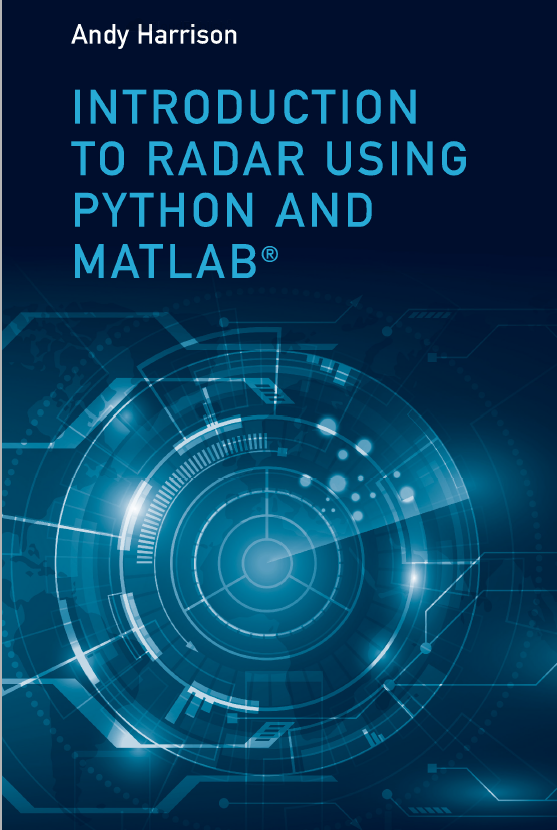

# Introduction to Radar Using Python and MATLAB®

1. Introduction to Radar Using Python and MATLAB®
This book first provides a general overview of radar, including its basic classifications, waveforms, applications, parameters, and the necessary MATLAB and Python code for the book's code. It then discusses fundamental electromagnetic field theory, antenna systems (beamwidth, power spectral density, gain, polarization methods, antenna types, etc.), radar ranging, radar reception, target detection, pulse compression, target tracking, and more.

## Images

<!-- PAYMENT_BLOCK -->

## Get this dataset

- Payment link (Stripe): [Buy now](https://buy.stripe.com/3cs8yP7sY87d0vu9AB)
- Payment QR code: 

<!-- /PAYMENT_BLOCK -->
